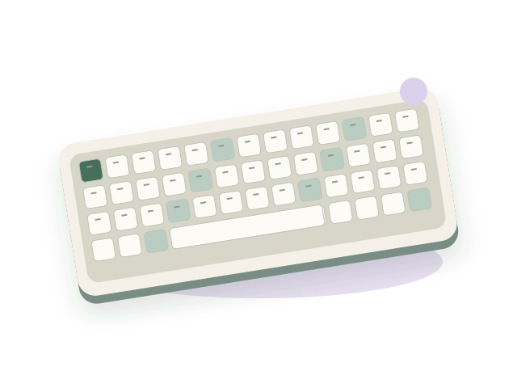

# Bài tập cá nhân buổi 2 HTML và CSS

**Sinh viên:** Trương Thanh Phong. **Ngày thực hiện:** 27/10/2026. **Sản phẩm:** Phong Select, tiếp tục từ buổi 1. Phạm vi hoàn thiện là danh sách/thẻ sản phẩm và menu hỗ trợ điều hướng. Dữ liệu bốn phụ kiện là giả định, được giữ nguyên từ bài trước.

## 1 Phân tích đề và phương án thực hiện

Đề gồm 23 trang, yêu cầu kế thừa mã buổi 1, rà soát ít nhất ba vấn đề, củng cố HTML5, dùng CSS ngoài, thực hành selector/Box Model/Flexbox, mở rộng Grid, thêm hover/focus, kiểm tra và ghi thay đổi. Phần nộp có mã, ảnh trước/sau, kiểm thử, AI, bảy câu hỏi kiến thức và cập nhật cùng repository GitHub.

Ảnh infographic ở trang 2 là bản minh họa quy trình. Các ví dụ ShopMate, áo thun và đường dẫn product-detail.html trong đề không phải yêu cầu đổi tên cửa hàng hoặc tạo trang chi tiết chưa có. Phong Select tiếp tục giữ nội dung buổi 1, không dùng framework và không bổ sung backend/JavaScript ở buổi này.

| Sản phẩm đề yêu cầu | Thành phần bàn giao |
|---|---|
| HTML kế thừa buổi 1 | index.html, giữ bốn phụ kiện và thương hiệu Phong Select |
| CSS ngoài được liên kết đúng | css/style.css; style.css ở gốc chỉ giữ tương thích |
| Ít nhất một cặp ảnh trước/sau | evidence/before/card-390.png và evidence/after/card-390.png; có thêm cặp products-1366.png |
| Ảnh khu vực hoàn thiện | evidence/after/products-1366.png, page-768.png và các ảnh mobile |
| Báo cáo kiểm thử và cách sửa | Mục 7 và evidence/after/results.json |
| Báo cáo AI | AI_USAGE.md và mục 8 |
| Bảy câu trả lời | Mục 9, dựa vào mã và thử nghiệm của bài |
| Cùng repository và README | Thư mục buoi-2 trong repository buổi 1; xuất bản bằng nhánh và PR được người dùng cho phép |

## 2 Rà soát nền buổi 1

Baseline là bản buổi 1 được khôi phục từ commit `dbb6bc22bbf86fdf3914a5ebcc28eda82e0b8630`. Đã chụp trang và đo DOM/CSS trước khi sửa. Bản cũ đã có header/nav/main/section/article/footer, h1/h2/h3, ảnh, CSS ngoài, Grid responsive và lọc nhóm; các mục dưới đây là điểm cần hoàn thiện, không được mô tả sai thành trang chưa có CSS hoặc không chạy.

| Điểm quan sát trong mã cũ | Hướng hoàn thiện | Kết quả mong muốn |
|---|---|---|
| Container sản phẩm là div chứa bốn article, menu chứa các a trực tiếp | Dùng ul/li cho tập sản phẩm và menu; giữ article cho mỗi sản phẩm | Cấu trúc thể hiện rõ quan hệ danh sách |
| H3 chưa có class riêng; CSS dùng product-card h3 ở nhiều chỗ; tên plan-details không sát nội dung | Thêm product-title, đổi các class plan thành product | Dễ tra selector và giải thích cascade |
| CSS chính nằm ở gốc thay vì cấu trúc css/style.css của bài thực hành | Tạo thư mục css, sửa link trong head; giữ entry cũ bằng @import | Tách và kiểm tra đường dẫn trình bày rõ ràng |
| Thẻ có details/summary nhưng chưa có liên kết a tới tài nguyên sản phẩm | Bổ sung Xem hình lớn trỏ đúng SVG | Thực hành liên kết thật, không tạo trang đích giả |
| Chữ giá phụ ở 11 px, padding nội dung ba giá trị chưa đồng nhất | Tăng giá phụ lên 12 px, dùng padding 24 px trên desktop và các mức nhỏ hơn cho mobile | Đọc thông tin giá và xác định Box Model thuận tiện hơn |

Thứ tự xử lý: giữ baseline và ảnh trước; sửa HTML/đường dẫn; tổ chức CSS và thẻ; điều chỉnh bộ lọc theo Grid item mới; thêm link và trạng thái; kiểm thử các kích thước và ghi bằng chứng.

## 3 Cấu trúc HTML5

Header chứa nhận diện và nav; main chứa nội dung chính; section nhóm nội dung có heading; mỗi article là một sản phẩm; footer kết thúc trang. Một h1 nêu chủ đề, h2 cho các khu vực và h3 cho bốn tên sản phẩm. Menu và sản phẩm là các danh sách ul/li. Cách chọn article dựa vào một đơn vị nội dung sản phẩm có thể hiểu độc lập, khác div là khối nhóm không tự bổ sung ý nghĩa đó. [HTML Living Standard](https://html.spec.whatwg.org/multipage/sections.html).

Ví dụ rút gọn từ cấu trúc thực tế:

```html
<ul id="product-grid" class="product-grid" role="list">
  <li class="product-item" data-category="input">
    <article class="product-card" aria-labelledby="ten-keyboard">
      <div class="product-visual visual-purple">
        
      </div>
      <div class="product-content">
        <h3 class="product-title" id="ten-keyboard">Bàn phím cơ K75</h3>
        <!-- Giá và details/summary giữ nội dung của bài -->
      </div>
    </article>
  </li>
</ul>
```

Img có src tương đối và alt mô tả hình. Liên kết ảnh dùng a với href có thật, target mở tab mới và rel phù hợp; thông tin hỗ trợ nêu tên sản phẩm và việc mở tab. Details/summary vẫn dùng để mở thông tin tại chỗ, không đổi thành liên kết giả. HTML đóng và lồng thẻ theo cấu trúc này; đã kiểm tra id duy nhất và các fragment trỏ đúng đích.

## 4 CSS ngoài selector và Box Model

Head liên kết trực tiếp `css/style.css`. Tệp gốc `style.css` giữ một @import để tham chiếu đường cũ không bị bỏ mất; trang chính không tải đồng thời hai stylesheet. Body tiếp tục dùng Arial/Helvetica/sans-serif và bảng màu xanh/kem của buổi 1; img có max-width và height auto. Không tải font hay framework ngoài.

Ba kiểu selector được thực hành:

| Kiểu | Ví dụ trong bài | Phạm vi |
|---|---|---|
| Element selector | body, img | Phần tử cùng tên |
| Class selector | .product-title, .product-content | Phần tử mang class tương ứng |
| Descendant selector | .product-card .product-image-link | Link có class đó nằm bên trong thẻ sản phẩm |

```css
* { box-sizing: border-box; }
.product-card {
  width: 100%;
  margin: 0;
  padding: 0;
  border: 1px solid var(--line);
  border-radius: 16px;
}
.product-content { padding: 24px; }
.product-title {
  min-height: 60px;
  font-size: 22px;
  line-height: 1.35;
  margin: 0 0 12px;
}
```

Đo tại viewport 1366 px: thẻ ngoài rộng 305 px, viền mỗi bên 1 px, padding 0. Khối `.product-content` rộng 303 px, không có viền, padding 24 px mỗi bên, phần nội dung còn 255 px. Công thức ngang: **305 = 1 + 303 + 1**; **303 = 24 + 255 + 24**. Không được viết rằng thẻ ngoài có padding 24 px.

Padding tạo khoảng bên trong viền; margin tạo khoảng bên ngoài phần tử. Trong bài, margin-bottom 12 px ở tiêu đề tạo khoảng với nội dung tiếp theo; padding 24 px ở khối nội dung tạo khoảng với các cạnh khối. Khoảng giữa các Grid item là gap 20 px trên desktop, không phải margin 20 px của từng card. Border-box đưa padding/viền vào kích thước khai báo, không bao gồm margin. [MDN Box Model](https://developer.mozilla.org/en-US/docs/Web/CSS/CSS_box_model/Introduction_to_the_CSS_box_model), [MDN box-sizing](https://developer.mozilla.org/en-US/docs/Web/CSS/box-sizing).

Tại ≤1100 px, `.product-content` có padding 23 px; tại ≤580 px là 22 px. Vì có media query, các số đo 24/255 px ở trên chỉ áp dụng điều kiện đo đã nêu, không suy cho mọi màn hình.

## 5 Flexbox và Grid

Menu là khu vực Flexbox nhỏ dùng ba li làm flex item:

```css
.main-nav-list {
  display: flex;
  flex-wrap: wrap;
  justify-content: flex-end;
  align-items: center;
  gap: 8px 24px;
  margin: 0;
  padding: 0;
  list-style: none;
}
```

Flex đặt trên cha ul. Justify-content căn theo trục chính; align-items căn theo trục vuông góc. Với row mặc định trong trang này, các item được sắp theo chiều ngang. Gap hai giá trị lần lượt là khoảng hàng và cột. Đã thử flex-start và space-between trên cùng vùng rộng 620 px: cấu hình thứ hai phân phối thêm không gian trống giữa item; gap vẫn là mức khoảng cách tối thiểu, không phải toàn bộ khoảng trống cuối. Ảnh thử có nhãn rõ trong evidence/after. [MDN Flexbox](https://developer.mozilla.org/en-US/docs/Web/CSS/CSS_flexible_box_layout/Basic_concepts_of_flexbox).

Danh sách tiếp tục dùng Grid:

```css
.product-grid {
  display: grid;
  grid-template-columns: repeat(4, minmax(0, 1fr));
  gap: 20px;
}
@media (max-width: 1100px) {
  .product-grid { grid-template-columns: repeat(2, minmax(0, 1fr)); }
}
@media (max-width: 580px) {
  .product-grid { grid-template-columns: minmax(0, 1fr); }
}
```

Repeat lặp định nghĩa track; 1fr chia phần không gian còn lại; minmax(0,1fr) cho phép track co xuống mức tối thiểu 0 thay vì bị nội dung dài ép rộng ngoài ý muốn. Gap tạo khoảng giữa track. Đã thử 2 và 3 cột với cùng bốn sản phẩm: 2 cột tạo hai hàng, 3 cột tạo hàng ba và hàng một. Cấu hình cuối vẫn là 4/2/1 theo viewport. [MDN Grid](https://developer.mozilla.org/en-US/docs/Web/CSS/CSS_grid_layout/Basic_concepts_of_grid_layout).

Hình SVG dùng object-fit: contain để thấy toàn bộ minh họa trong khung. Cover cũng giữ tỷ lệ nhưng lấp đầy khung và có thể cắt bớt ảnh; không phải kéo giãn. Bài không đổi sang cover một cách máy móc theo ví dụ đề vì hình minh họa cần được nhìn đủ. [MDN object-fit](https://developer.mozilla.org/en-US/docs/Web/CSS/object-fit).

## 6 Hover focus và liên kết

Liên kết `.product-image-link` được tạo trong phần thông tin mở rộng, trỏ tới SVG thực. Nền bình thường #174e3c, hover #103b2e, transition 180 ms. Focus-visible dùng outline 3 px màu #81520c, offset 4 px. Outline không chiếm thêm diện tích trong Box Model nên không đẩy bố cục như tăng border.

Hover là trạng thái con trỏ ở trên phần tử; focus là phần tử đang nhận tương tác/nhập bàn phím. Focus-visible áp dụng theo đánh giá của trình duyệt khi cần hiển thị dấu focus, thường quan trọng khi dùng Tab. Đã thử mở details bằng Enter, Tab đến link, thấy outline và mở đúng SVG trong tab mới. Reduced-motion tắt transition; không coi hover là cách phản hồi duy nhất. [MDN focus-visible](https://developer.mozilla.org/en-US/docs/Web/CSS/:focus-visible).

## 7 Kiểm thử thay đổi và minh chứng

Môi trường: Windows, Chrome 155.0.8059.85, Playwright từ runtime có sẵn; qua HTTP cục bộ và file://. Ngày thực hiện 27/10/2026. **104 kiểm tra, 104 đạt, 0 thất bại**, không ghi nhận lỗi HTTP/request/JavaScript trong lượt thử.

| Nhóm | Số kiểm tra | Kết quả |
|---|---:|---|
| Layout và ảnh/fragment ở 10 viewport | 20 | Không tràn; đúng cột; ảnh tải và đích fragment tồn tại |
| Bốn lựa chọn bộ lọc tại 10 viewport | 40 | Đúng tập 4/2/1/1 và nhãn kết quả |
| Reset tại 10 viewport | 10 | Khôi phục bốn thẻ |
| Vị trí sau lọc, ngữ nghĩa và CSS ngoài | 3 | Không giữ ô trống; một h1/main; CSS đúng đường dẫn |
| Details, tài nguyên ảnh, hover/focus và popup | 15 | Bốn thẻ mở/đóng; link/outline/chuyển màu hoạt động |
| Radio/reset bằng bàn phím | 2 | Hoạt động bằng mũi tên và Enter |
| Box Model và bốn bộ giá | 5 | Computed style và phép tính đúng |
| Grid 2/3, Flex hai kiểu và bỏ Grid | 5 | Kết quả phù hợp dự đoán |
| Reduced-motion và mở trực tiếp tệp | 4 | Tắt transition; ảnh/CSS/filter/reset hoạt động |

Các độ rộng và số cột: 1366/1101 → 4; 1100/1024/768/581 → 2; 580/390/375/320 → 1. Ba kích thước đề gợi ý đã được thử; có thêm các cặp sát breakpoint để kiểm tra điều kiện media query.

**Điều chỉnh sau rà soát:** chữ giá phụ ở 11 px được tăng lên 12 px và xem lại trên mobile. Đây là quyết định cải thiện khả năng đọc, chưa phải kết luận từ một nghiên cứu người dùng. Khi chuyển danh sách sang li, selector lọc được sửa để ẩn `.product-item`, bảo vệ bố cục Grid thay vì chỉ ẩn article bên trong. Test lọc nhóm âm thanh xác nhận thẻ còn lại xuất hiện ngay ô đầu, không để khoảng trống từ hai item đã ẩn.

Ảnh trước/sau được chụp ở cùng viewport: before/card-390.png và after/card-390.png; before/products-1366.png và after/products-1366.png. Ảnh focus, hover, các thử nghiệm Flex/Grid và log nằm trong evidence. Nội dung buổi 1 được kiểm mã băm trước/sau và giữ nguyên.

Chưa thử thiết bị thật, Safari/Firefox, trình đọc màn hình hoặc audit WCAG đầy đủ. Không báo kết quả của công cụ chưa chạy. Việc chụp, kiểm thử và sửa mã trong phiên này do trợ lý thực hiện; phiếu tự thực hành của sinh viên được để riêng.

## 8 Sử dụng AI và đối chiếu

AI hỗ trợ đọc đề, rà soát baseline, đề xuất thay đổi nhỏ, sửa mã, giải thích và kiểm tra. Chín khung tác vụ P1-P9 cùng kết quả và quyết định giữ/sửa nằm trong AI_USAGE.md. Đề xuất phải được đối chiếu với mã và browser: ví dụ không kết luận baseline thiếu semantic landmarks; không ghi padding 24 px thuộc thẻ ngoài; không thêm liên kết product-detail.html khi chưa có trang đó.

Những prompt được trình bày là khung đã áp dụng từ đề, không được dựng thành ảnh hội thoại hoặc khai thành các tin nhắn sinh viên đã gửi. Người dùng đã cho phép xuất bản vào nhánh/PR riêng. Không ghi thay rằng người học đã tự chỉnh một điểm trong buổi bảo vệ.

## 9 Trả lời bảy câu hỏi kiến thức

### Câu 1 Những phần tử HTML5 được dùng và lý do

Header chứa nhận diện đầu trang, nav chứa ba liên kết điều hướng, main chứa nội dung chính, section chia các nhóm có heading, article mô tả từng sản phẩm và footer chứa phần kết. Ul/li biểu đạt menu và danh sách bốn sản phẩm. H1 là chủ đề, h2 là khu vực, h3 là tên mặt hàng. Img/alt phục vụ hình và mô tả thay thế; a dùng cho fragment và mở SVG; details/summary mở thông tin tại chỗ. Không thêm một landmark chỉ để tăng số loại thẻ.

### Câu 2 Margin khác padding trong thẻ cụ thể

Padding nằm bên trong viền của phần tử; margin nằm bên ngoài. Trong bài, `.product-content` có padding 24 px ở desktop, còn `.product-title` có margin-bottom 12 px. Thẻ ngoài `.product-card` có padding/margin 0 và viền 1 px; khoảng cách giữa các card do gap của Grid. Đo ở 1366 px: thẻ 305 px gồm hai viền và khối trong 303 px; khối trong gồm hai padding 24 px và vùng nội dung 255 px. Border-box không tính margin vào width. Mobile có quy tắc padding khác nên cần đọc cascade.

### Câu 3 Flexbox nằm ở đâu và cách căn trục

`.main-nav-list` dùng display:flex; ba li trực tiếp là flex item. Justify-content:flex-end đưa nhóm về cuối trục chính khi có không gian dư; align-items:center căn giữa theo trục vuông góc. Với row của bài, hai trục tương ứng ngang và dọc. Gap:8px 24px tách hàng và cột; flex-wrap cho phép xuống dòng. Trong thí nghiệm menu rộng 620 px, space-between phân phối thêm khoảng trống giữa các item, khác flex-start gom về đầu. Ở mobile, media query thay các giá trị theo chiều rộng.

### Câu 4 Grid khác Flexbox và lý do dùng Grid

Flexbox tập trung sắp item trên một trục; Grid định nghĩa các track theo hàng và cột. Menu phù hợp Flex vì là một nhóm liên kết cần căn theo hàng. Danh sách sản phẩm phù hợp Grid vì cần cột đều và đổi số cột theo viewport. Bản cuối dùng repeat(4,minmax(0,1fr)), rồi 2 và 1 cột tại breakpoint. Hai thử nghiệm 2/3 cột với cùng bộ dữ liệu cho thấy cấu hình cột thay đổi cách bốn sản phẩm phân bố thành hàng.

### Câu 5 Nếu bỏ display grid

Khi không còn display:grid và không có quy tắc display khác thay thế, ul trở về block; các li trong mã này xếp theo dòng khối, thường lần lượt xuống dưới và có chiều rộng vùng chứa. Grid-template-columns không còn tạo cột, gap không còn tạo khoảng Grid. Thử style tạm display:block trong browser đã xác nhận bốn item thẳng cột; mã cuối được trả về Grid. Đây không phải mất ảnh hay mất nội dung, mà là thay cơ chế bố cục.

### Câu 6 Vì sao ảnh cần alt

Alt cung cấp văn bản thay thế khi hình không tải hoặc người dùng tiếp cận bằng công nghệ đọc văn bản. Ví dụ ảnh bàn phím mô tả K75, phím kem và điểm nhấn xanh, phù hợp nội dung SVG. Không viết mọi ảnh là “ảnh sản phẩm”, không biến alt thành quảng cáo hoặc khẳng định tính năng không có căn cứ. Width/height giúp xác định tỷ lệ và chỗ cho ảnh, còn alt có vai trò nội dung khác.

### Câu 7 Một đề xuất AI đã kiểm tra hoặc điều chỉnh

Phương án thêm ul/li được kiểm tra cùng bộ lọc CSS kế thừa. Vì Grid item đã là li, quy tắc ẩn phải chọn `.product-item`, không chỉ article. Bản thực hiện dùng selector đúng và kiểm tra nhóm âm thanh: chỉ còn tai nghe, nhãn “1 sản phẩm” và tọa độ nằm ở ô đầu. Một điểm đối chiếu khác là Box Model: số đo browser xác nhận padding 24 px thuộc `.product-content`. Những kết quả này là kiểm chứng của trợ lý trong phiên; phần sinh viên tự sửa cần được người học tự ghi nhận.

## 10 Chuẩn bị sửa mã trực tiếp và tiếp nối

Năm yêu cầu giảng viên có thể chọn đã được hướng dẫn trong SUA_MA_TRUC_TIEP.md: đổi padding nội dung, màu giá, số cột, gap menu và alt. Mỗi ví dụ chỉ ra selector, kết quả dự đoán và ảnh hưởng media query. Người học nên tự thực hiện một thay đổi và ghi ảnh/commit của chính mình vào phiếu cuối tệp.

Bài buổi 2 tiếp tục trong cùng repository của buổi 1, ở thư mục riêng để giữ mốc. GitHub được cập nhật bằng nhánh và PR theo xác nhận của người dùng; main giữ nguyên đến khi được merge theo quyết định sau. Link và commit xác minh nằm trong hồ sơ xuất bản của gói bàn giao.

Nền cho buổi 3: giữ cấu trúc danh sách, data-category, tên/giá và vùng thông tin để sau này bổ sung JavaScript theo đề. Chưa tự thêm tìm kiếm từ khóa, sắp xếp hay giỏ hàng vào buổi 2.

## Nguồn

- TS. Nguyễn Mạnh Tuấn, BaiTap_CaNhan_Buoi2.pdf do người dùng cung cấp; yêu cầu chính trang 3-23, infographic trang 2.
- Mã Phong Select buổi 1, snapshot dbb6bc22bbf86fdf3914a5ebcc28eda82e0b8630.
- HTML Living Standard và các tài liệu MDN đã dẫn gần nội dung; đối chiếu ngày 27/10/2026.
- Minh chứng tự thu và kết quả máy đọc trong evidence/before và evidence/after.
